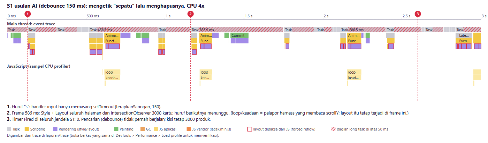
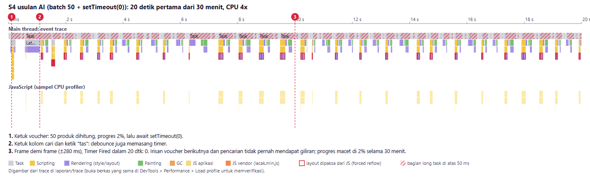
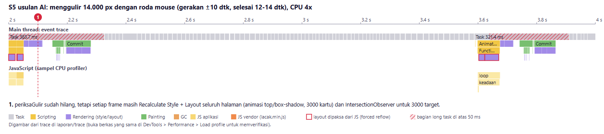

# Audit usulan perbaikan dari AI

Peran kami di sini adalah **reviewer**. Kami meminta sebuah AI memperbaiki tiga tiket di branch terpisah, lalu
menguji usulannya dengan protokol pengukuran yang sama persis dengan pengukuran utama (TUGAS.md bagian 7,
`laporan/skrip/ukur.mjs`, CPU 4x, 3 ulangan, median).

Alat AI yang dipakai:
**Claude Sonnet**, dijalankan sebagai sub-agen yang terpisah dari asisten utama (Claude Code).
Sub-agen ini tidak punya akses ke trace, alat ukur, maupun temuan kami, dan hanya membaca repositori kode awal.
Branch atau commit tempat usulan diterapkan: **`audit-ai`** (bercabang dari kode awal `3dfa4fb`), yaitu `dcdc02b`
(TK-1041), `b12d309` (TK-1057), dan `0ffec9c` (TK-1063). Data: `laporan/data/ai/hasil.json` dan
`laporan/data/<label>/uji-voucher-sela.json`. Trace: `laporan/trace/S*-ai.json.gz`.

**Prompt yang diberikan (sama untuk ketiga tiket, ringkas):** "Baca TUGAS.md dan README.md. Tolong perbaiki tiket
TK-1041 (ketik di kolom cari telat/hang), TK-1057 (voucher KILAT1212 bikin layar beku, progres cuma 0% lalu langsung
selesai), dan TK-1063 (scroll daftar produk patah-patah). Ikuti aturan main di TUGAS.md bagian 5 (jangan ubah
server.js, public/vendor/, public/alat/; tanpa framework/library; fitur tidak boleh hilang). Kamu tidak punya akses
ke Chrome DevTools atau trace performa; kerjakan berdasarkan membaca kode. Buat satu commit per tiket."

Hasil ukur ringkas (median 3 ulangan, CPU 4x):

Angka "frame > 50 ms per 10 dtk" di S5 terlihat lebih baik pada kode awal (0,9), dan hampir sama antara usulan AI (6,6)
dan perbaikan tim (6). Itu karena metrik ini menghitung *jumlah* frame lambat. Bila main thread hanya menghasilkan 4
frame dalam 32 detik (kode awal) atau 6-12 frame dalam 12-14 detik (usulan AI), jumlah frame lambatnya pun sedikit,
walaupun tiap frame sangat panjang dan guliran terlambat. Perbaikan tim menghasilkan ±460 frame dalam 10 detik,
dengan frame terburuk 61 ms. Karena itu kami juga melaporkan fps, frame terburuk, dan waktu menggulir (LAPORAN
bagian 3). Kolom "perbaikan tim" diukur pada malam 26-09, sedangkan kolom lain diukur pagi (LAPORAN bagian 3,
catatan kondisi mesin).

Catatan: penjelasan mekanisme dari AI **tepat untuk bagian kode yang dibacanya**. AI membedakan microtask dari task,
mengenali layout paksa, dan menemukan loop 40x yang sia-sia. Masalahnya ada pada hal yang tidak terlihat dari
membaca kode: biaya mana yang sebenarnya dominan, interaksi antar-komponen, dan ritme input sungguhan.

| Skenario | Metrik                                           | Kode Awal           | Usulan AI                                                  | Perbaikan Tim             | Target     |
| -------- | ------------------------------------------------ | ------------------- | ---------------------------------------------------------- | ------------------------- | ---------- |
| S0       | Long task terlama saat memuat                    | 14.402 ms           | 11.066 ms                                                  | 720 ms                    |            |
| S1       | INP                                              | 64.302 ms           | 923 ms (pencarian tidak berjalan, lihat A-01)              | 96 ms                     | <= 200 ms  |
| S1       | `Timer Fired` selama mengetik (5,9 dtk)        | 0                   | 0                                                          | (tidak perlu timer)       |            |
| S4       | INP                                              | 51.233 ms           | 14.040 ms                                                  | 72 ms                     | <= 200 ms  |
| S4       | Ketuk voucher sampai selesai                     | 51.163 ms           | **tidak selesai dalam 1.800 dtk** (3 dari 3 ulangan) | 1.207 ms                  |            |
| S4       | Langkah progres tergambar / frame selama progres | 0 / 0               | 1 / 3.854                                                  | 3 / 4                     | bertahap   |
| S4       | Hasil pencarian "tas" tampil                     | ya, setelah voucher | tidak, setelah 30 menit                                    | ya, di tengah perhitungan |            |
| S5       | Waktu menggulir 14.000 px (seharusnya ±10 dtk)  | 32.433 ms           | 13.473 ms                                                  | 10.096 ms                 |            |
| S5       | Frame main thread per detik / frame terburuk     | 0,1 fps / 21.012 ms | 0,7 fps / 2.252 ms                                         | 46 fps / 61 ms            |            |
| S5       | Frame > 50 ms per 10 dtk                         | 0,9                 | 6,6                                                        | 6                         | <=2        |
| S6       | Frame > 50 ms per 10 dtk / main thread sibuk     | 20 / 96,8%          | 21 / 96,6%                                                 | 0 / 39,1%                 | <= 2       |

---

### A-01: Debounce membuat pencarian tidak pernah berjalan di HP lambat

- **Tiket yang diminta diperbaiki:** TK-1041.
- **Prompt yang diberikan (ringkas):** lihat di atas.
- **Usulan AI (ringkas):** commit `dcdc02b`. Render kisi ditunda sampai 150 ms setelah huruf terakhir, dan
  `samakanTinggiJudul` dipisah menjadi "tulis semua, baca semua, tulis semua" (1 layout paksa, bukan 24).
  ```js
  // pencarian.js
  kolom.addEventListener('input', () => {
    saringan.kata = kolom.value;
    clearTimeout(pewaktuDebounce);
    pewaktuDebounce = setTimeout(terapkanSaringan, 150);
  });
  // katalog.js, samakanTinggiJudul()
  contoh.forEach((j) => { j.style.height = 'auto'; });
  contoh.forEach((j) => { if (j.offsetHeight > tertinggi) tertinggi = j.offsetHeight; });
  judul.forEach((j) => { j.style.height = tertinggi + 'px'; });
  ```
- **Jenis masalah pada usulan:**
  - [X] Salah diagnosis (memperbaiki hal yang bukan penyebab)
  - [X] Tidak lengkap (gejala berkurang tetapi akar masalah masih ada)
  - [X] Menimbulkan regresi (hasil pencarian tidak muncul)
  - [ ] Melanggar aturan main
  - [ ] Memperbaiki sesuatu yang tidak berpengaruh terukur
- **Bukti:**
  - Sekilas usulan ini tampak berhasil: INP S1 turun dari 64.302 ms ke **923 ms** dan long task S1 dari 41.983 ms ke
    584 ms. Pemisahan baca/tulis di `samakanTinggiJudul` memang nyata hasilnya: long task saat memuat turun dari
    14.402 ms ke 11.066 ms.
  - Trace `S1-ai.json.gz` (gambar `g13-S1-ai.png`) menunjukkan penyebab sebenarnya penurunan INP: **0 `Timer Fired` selama 5,9 detik S1**. Callback debounce (`terapkanSaringan`) tidak pernah berjalan, jadi kisi tidak
    pernah disaring saat "sepatu" diketik. INP turun karena pekerjaannya tidak dikerjakan, bukan karena lebih
    cepat.
  - S4 memperlihatkan akibatnya bagi pengguna: kata "tas" sudah ada di kolom cari, tetapi setelah **30 menit**
    ringkasan masih "3.000 produk ditampilkan" di ketiga ulangan (`laporan/data/ai/hasil.json`, status terakhir S4).
  - Sisa INP 923 ms berasal dari frame yang tetap berat, 200-600 ms per frame: animasi `top`/`box-shadow`
    lencana, 3000 kartu di DOM, dan IntersectionObserver usulan AI yang mengamati 3000 kartu
    (`IntersectionObserverController::computeIntersections` 20-60 ms per frame). Setiap huruf menunggu di belakang
    frame tersebut.
- **Mengapa AI bisa keliru di sini:** AI melihat "render di handler `input`" dan memakai obat bakunya, yaitu
  mengurangi *frekuensi* render. Dari kode saja AI tidak bisa melihat dua hal. Pertama, satu render 3000 kartu di HP
  lambat memakan detik, sehingga yang harus dikurangi adalah *biaya per render*; lagi pula di HP orang mengetik
  dengan jeda ±200 ms, lebih lama dari 150 ms. Kedua, di halaman ini `setTimeout` hampir tidak pernah mendapat
  giliran. Halaman terus-menerus menggambar frame yang masing-masing lebih dari 100 ms. Menurut trace, penjadwal
  Chrome mendahulukan frame yang tertunda dan input di atas task timer, sehingga timer "kelaparan". Gejala yang
  sama muncul di kode awal: 0 `Timer Fired` di S6, hitung mundur macet, banner tidak pernah tampil. Ini sifat
  halaman itu sendiri, bukan efek alat ukur: tanpa alat ukur dan tanpa pelapor harness pun, S6 kode awal tetap 0
  `Timer Fired` dalam 10 detik (sibuk 95,8%, `laporan/data/sebelum-tanpa-ukur`). Debounce
  menaruh pekerjaan penting di antrean yang paling tidak didahulukan.
- **Perbaikan yang benar menurut tim:** kurangi biaya per render dan biaya per frame (LAPORAN T-01, T-08, T-10):
  render bertahap 12 kartu, pemformat Intl sekali, tinggi judul lewat CSS `line-clamp`, teks pencarian
  dinormalkan sekali, kartu dipakai ulang, dan animasi dipindah ke compositor. Hasilnya INP S1 96 ms **tanpa**
  debounce, dengan setiap huruf langsung memperbarui hasil.

## A-02: Voucher diiris dengan `setTimeout(0)`: di HP lambat tidak pernah selesai, dan hasilnya bisa salah

- **Tiket yang diminta diperbaiki:** TK-1057.
- **Prompt yang diberikan (ringkas):** lihat di atas.
- **Usulan AI (ringkas):** commit `b12d309`. Loop 40x `simulasiCicilan` dihapus (tepat), dan setiap 50 produk
  loop menyerahkan giliran lewat `setTimeout(0)`
- ```js
  keadaan.hargaVoucher.clear();
  for (const produk of keadaan.semuaProduk) {
    const hasil = hitungHargaPromo(produk, aturan);
    if (hasil) keadaan.hargaVoucher.set(produk.id, hasil.hargaAkhir);
    selesai++;
    if (selesai % UKURAN_BATCH === 0 || selesai === total) {
      /* perbarui progres */
      await tungguGiliranBerikutnya();          // new Promise((r) => setTimeout(r, 0))
    }
  }
  perbaruiHargaVoucherDiKartu();                // = renderProduk(semua yang ditampilkan)
  ```
- **Jenis masalah pada usulan:**

  - [ ] Salah diagnosis
  - [X] Tidak lengkap (gejala berkurang tetapi akar masalah masih ada)
  - [X] Menimbulkan regresi (voucher tidak selesai; hasil salah bila disela)
  - [ ] Melanggar aturan main
  - [ ] Memperbaiki sesuatu yang tidak berpengaruh terukur
- **Bukti:**

  - **Voucher tidak pernah selesai.** Di ketiga ulangan S4, perhitungan belum selesai setelah batas tunggu 1.800
    detik. Kode awal selesai dalam 51 detik. Progres berhenti di **"2% (50 dari 3000 produk)"**, yaitu irisan pertama, walau ada 3.854 frame
    selama progres tampil. Trace `S4-ai.json.gz` (gambar `g14-S4-ai.png`) berisi hanya **2 `Timer Fired` dalam 30 menit**,
    sedangkan frame ±200 per menit. Setiap giliran loop menunggu `setTimeout(0)`, dan di halaman ini timer hampir
    tidak pernah dipilih penjadwal selama frame terus tertunda (lihat A-01). Kode awal tidak mengalami ini justru
    karena loopnya satu task.
  - **Tanpa alat ukur pun tidak selesai.** `uji-voucher-sela.mjs` (kasus 0: CPU 4x, tanpa alat ukur dan tanpa loop
    apa pun di halaman) mengamati halaman hanya lewat pesan `console.debug` dari `MutationObserver`. Dengan cara ini
    tidak ada frame atau timer tambahan, dan pengamatan tetap jalan walaupun main thread kelaparan. Hasilnya, progres
    berhenti di **2%** selama lebih dari 3 menit pengamatan. Kode awal dalam kondisi yang sama selesai 10,4 detik
    setelah progres tampil, karena loopnya satu task. Uji fungsional versi AI (CPU 1x, setelah langkah cari, saring,
    dan urut) juga berhenti di langkah voucher: toast "dipakai" tidak muncul dalam 120 detik, sedangkan 11
    pemeriksaan sebelumnya lulus.
  - **Harga tampil sebagian bila disela** (`uji-voucher-sela.mjs` kasus 2, CPU 1x). Urutan diganti ke "Harga
    tertinggi" saat progres 30%. Dari 12 kartu teratas yang berhak mendapat voucher, hanya **4** yang menampilkan
    harga voucher. Delapan lainnya tampil tanpa potongan sampai perhitungan selesai ±8 detik kemudian, dan pada
    CPU 4x tidak pernah. Kode awal tidak bisa disela sama sekali, karena perhitungannya satu task. Versi tim menukar
    hasil sekaligus, jadi kartu tidak pernah menampilkan harga sebagian (lihat catatan di bawah). Ketukan kedua di
    tengah perhitungan (kasus 1) tidak menghasilkan jumlah yang salah dalam uji ini (toast 2.264, sesuai harapan).
  - **Membeku di akhir:** setelah loop, `perbaruiHargaVoucherDiKartu()` membangun ulang seluruh kisi dalam satu task.
    Masalah ini tidak sempat terukur di S4 karena loop tidak pernah selesai.
  - *Catatan tentang versi tim:* `Runtime.evaluate` dari DevTools tidak bisa menyela perhitungan versi tim, karena
    lanjutan `scheduler.yield()` didahulukan di atas task DevTools, sehingga uji ini selalu mencatat "tidak-tersela"
    untuk versi tim. Input sungguhan tetap bisa menyela: di S4, ketikan "tas" masuk di tengah perhitungan.
    Konsistensi harga pada versi tim dijamin oleh rancangannya, bukan dibuktikan oleh uji otomatis ini.
- **Mengapa AI bisa keliru di sini:** AI memeriksa loop voucher secara terpisah dan benar soal microtask. Ada tiga
  hal yang tidak terlihat. Pertama, *antrean mana* yang dipakai untuk menyerahkan giliran itu penting: di halaman yang
  frame-nya berat, task timer kalah dari frame, sehingga `setTimeout(0)` bisa tertunda tanpa batas. Hanya trace
  yang memperlihatkannya (2 `Timer Fired` dalam 30 menit). Kedua,
  `perbaruiHargaVoucherDiKartu()` ada di berkas lain dan namanya terdengar ringan, padahal isinya `renderProduk`
  untuk semua kartu yang ditampilkan (3000 kartu = belasan detik pada CPU 4x, LAPORAN T-01). Ketiga, kode awal *secara kebetulan atomik*: karena semuanya satu task, tidak ada kode lain yang bisa berjalan di tengah
  perhitungan. Begitu loop menyerahkan giliran, handler lain (ketukan kedua, ganti urutan, pencarian) bisa berjalan
  di antara irisan dan membaca `keadaan.hargaVoucher` yang setengah terisi, atau mengosongkannya. AI memperbaiki
  responsivitas tanpa menambahkan pembatalan dan tanpa menukar hasil secara atomik.
- **Perbaikan yang benar menurut tim:** LAPORAN T-02. Irisan berdasarkan waktu (±8 ms), bukan jumlah produk, dan
  menyerahkan giliran lewat `scheduler.yield()`, yang melanjutkan pekerjaan dengan prioritas lebih tinggi daripada
  task baru (cadangan `MessageChannel`, tanpa jeda minimum 4 ms timer bersarang). Biaya per frame juga diturunkan
  (T-08), sehingga frame tidak lagi menghabiskan seluruh main thread. Hasil dihitung ke `Map` baru lalu ditukar sekali di akhir. Penerapan baru membatalkan yang lama
  (nomor generasi), dan harga di kartu yang sudah ada diperbarui di tempat, bukan dengan merender ulang kisi.

---

## A-03: Gulir: IntersectionObserver tepat, tetapi kerja per frame dan listener sentuh non-pasif dibiarkan

- **Tiket yang diminta diperbaiki:** TK-1063.
- **Prompt yang diberikan (ringkas):** lihat di atas.
- **Usulan AI (ringkas):** commit `0ffec9c`. `periksaGulir` diganti IntersectionObserver (efek muncul + impresi) dan
  rAF (header, bar), `touchstart` dijadikan pasif, dan listener `wheel` dihapus. Listener `touchmove` **tetap
  non-pasif**, dan callback observer masih membaca geometri tepat setelah menambah kelas:

  ```js
  utama.addEventListener('touchmove', (e) => { /* cegah pull-to-refresh */ }, { passive: false });
  function tandaiTerlihat(kartu) {
    kartu.classList.add('terlihat');                                              // tulis gaya
    kartu.style.minHeight = Math.round(kartu.getBoundingClientRect().height) + 'px'; // baca -> layout paksa
  ```

  CSS animasi (`.lencana-kilat` pada `top`/`box-shadow`, `.kartu` pada `margin-top`), timer 10 ms, dan 3000 kartu
  di DOM tidak disentuh.
- **Jenis masalah pada usulan:**

  - [ ] Salah diagnosis
  - [X] Tidak lengkap (gejala berkurang tetapi akar masalah masih ada)
  - [ ] Menimbulkan regresi
  - [ ] Melanggar aturan main
  - [ ] Memperbaiki sesuatu yang tidak berpengaruh terukur
- **Bukti:**

  - S6 (diam) **tidak berubah** dari kode awal: 21 frame > 50 ms per 10 detik (kode awal 20), main thread sibuk 96,6%
    (kode awal 96,8%). Biaya per frame (animasi `top`/`box-shadow`, 3000 kartu, timer 10 ms) tidak disentuh.
  - S5: guliran 14.000 px butuh **13,5 detik** (kode awal 32,4; perbaikan tim 10,2), main thread hanya 0,7 frame per
    detik, frame terburuk 2,3 detik. Pengguna masih melihat konten yang belum tergambar dan header/bar yang terlambat.
  - Trace `S5-ai.json.gz` (gambar `g15-S5-ai.png`): di setiap frame masih ada Recalculate Style + Layout seluruh
    halaman, ditambah `IntersectionObserverController::computeIntersections` untuk 3000 target.
  - `touchmove` non-pasif tidak bisa kami ukur langsung, karena CDP headless tidak mengirim guliran sentuh
    sintetis (LAPORAN bagian 2). Mekanismenya kami nilai dari kode dan S6: dengan main thread sibuk ±97%,
    compositor yang harus menunggu handler `touchmove` akan menunggu ratusan milidetik, betapapun ringan
    handler-nya.
- **Mengapa AI bisa keliru di sini:** AI hanya diminta memperbaiki "scroll" dan mencari penyebabnya di kode yang
  berhubungan dengan scroll (`gulir.js`). Trace S6 memperlihatkan bahwa main thread sudah hampir penuh **bahkan saat
  halaman diam**, akibat animasi CSS yang memicu Layout/Paint dan timer 10 ms di berkas lain. Selama itu ada,
  setiap frame gulir yang membutuhkan main thread tetap terlambat. AI juga mempertahankan `touchmove` non-pasif
  demi mencegah pull-to-refresh. Selama listener itu ada, compositor harus menunggu main thread sebelum menggulir
  dengan jari. Untuk handler seringan apa pun, waktu tunggunya ditentukan oleh seberapa sibuk main thread, bukan
  oleh isi handler.
- **Perbaikan yang benar menurut tim:** LAPORAN T-07 dan T-08. `overscroll-behavior-y: contain` menggantikan
  listener sentuh, jadi tidak ada listener non-pasif sama sekali. Animasi dipindah ke `transform`/`opacity`, timer
  dikurangi menjadi 1x per detik, kisi dirender bertahap, `content-visibility: auto` dipasang pada kartu, dan gambar
  tidak dimuat saat dikibas.

---

## Refleksi (maks. 200 kata)

AI paling membantu untuk pekerjaan yang hasilnya bisa diperiksa: menulis harness CDP dan pengurai trace, menjelaskan
mekanisme (microtask vs task, layout paksa) dengan bahasa yang jelas, menemukan semua tempat SDK dipanggil, menulis
uji fungsional, dan menyusun draf teks. Di bagian ini AI sangat mempercepat pekerjaan, dan kesalahannya cepat
ketahuan lewat uji atau trace.

Kami harus paling waspada saat AI memilih *apa* yang diperbaiki. Ketiga usulan di atas masuk akal saat dibaca, dan
komentar kodenya meyakinkan, tetapi AI memperbaiki bagian yang paling mencolok di kode, bukan yang paling mahal di
trace. Kami menemukan dua pola. Pertama, obat baku (debounce, `setTimeout(0)`) diterapkan tanpa mengetahui biaya per
panggilan dan ritme input. Kedua, perbaikan lokal mengubah sifat global: loop yang tadinya atomik menjadi bisa
disela. Asisten utama kami pun meleset dalam beberapa prediksi (P-14, P-15, transisi kartu) dan baru terkoreksi
setelah diukur. Aturan yang kami pakai: perubahan hanya diterima bila ada trace sebelum/sesudah dan uji
fungsionalnya lulus, dan setiap klaim "lebih cepat" harus disertai angka dari protokol yang sama.

Lampiran
========

Digambar oleh `laporan/skrip/buat-gambar.mjs` dari trace di `laporan/trace/` (bandingkan dengan `g3`/`g4`, `g7`/`g8`,
dan `g9`/`g10` di lampiran LAPORAN).

**g13-S1-ai** (A-01; trace `trace/S1-ai.json.gz`)



**g14-S4-ai** (A-02; trace `trace/S4-ai.json.gz`, 30 menit, ditampilkan 20 detik pertama)



**g15-S5-ai** (A-03; trace `trace/S5-ai.json.gz`)


